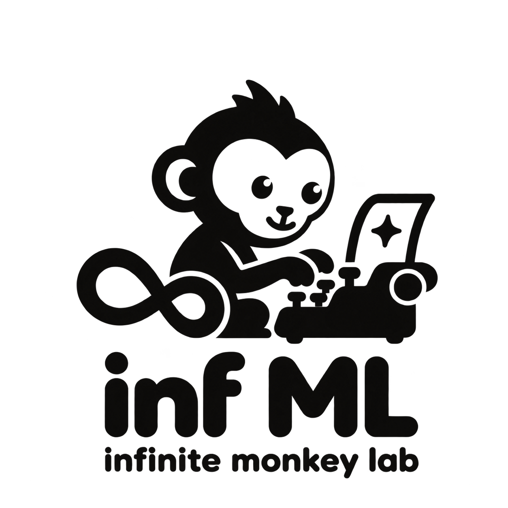
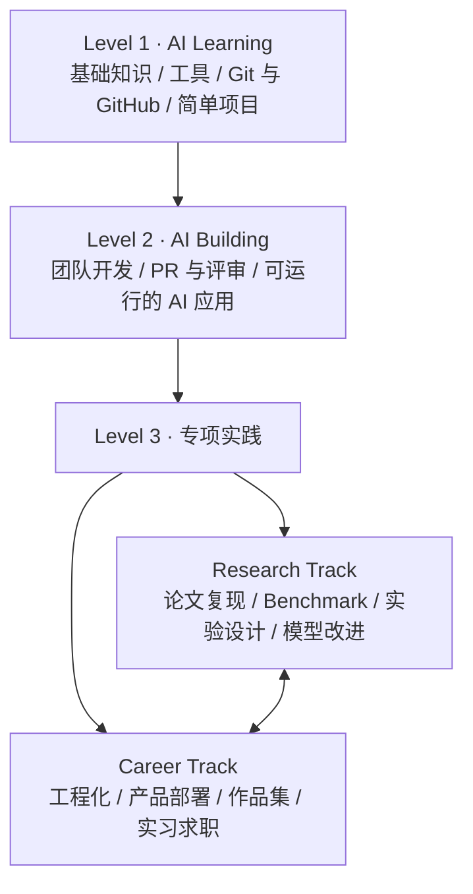

# 无限猴子实验室 · Infinite Monkey Lab

  

**人人可参与的 AI 开源共创实验室**

**不断尝试，共同创造。 · Keep Trying. Create Together.**

## 为什么叫「无限猴子」

名字借用了「无限猴子」的思想实验：在理想化的无限随机尝试中，猴子在打字机上也可能敲出莎士比亚的《哈姆雷特》。

面对 AI 展现出的能力，我们愿意把自己比作坐在打字机前的猴子：知识有限，未必一开始就知道怎样创造，但仍然可以开始尝试。借助 AI 提问、动手、观察结果，再验证、修改和重来，普通人也有机会做出原本做不出的东西。

这里的「无限」寄托着持续探索与人人参与的愿望。每个人的一次小尝试、一份失败记录、一点改进，都可以成为下一位参与者的起点。我们把过程与成果开放，让尝试能够被看见、被检验、被接续。

**不断尝试，共同创造。** 从一个问题、一段文档、一个实验或一个小工具开始；用反馈积累经验，用验证判断成果的价值。

从学习 AI，到参与开源项目，再到独立开展科研或开发实际应用。

我们希望让每个人通过真实的开源贡献，获得可验证的技术能力、科研经验和就业作品。以 **AI 应用项目** 为学习载体，以 **科研与就业** 为两条成长方向，以 **GitHub 上可追溯的贡献与成果** 记录成长。

面向所有人，以 GitHub 为核心平台，连接跨背景、跨地区的技术学习、科研实践、项目开发和就业能力培养。采用开放贡献、项目负责人和同伴指导的协作方式。

> 当前状态：筹备中。本仓库是社区入口与共创手册；课程、应用代码和研究成果将随着贡献逐步积累。路线图中的项目均为计划，尚未完成。

筹备与维护入口：**[社区启动方案](docs/launch-plan.md)** · **[招募与参与规则](docs/recruitment.md)** · **[前三个月路线图](ROADMAP.md)**。现阶段继续完善本仓库，四仓库组织架构为未来扩展计划。

## 开源所有，人人参与

无限猴子实验室是独立的社区共创项目。这里不限学生身份、学历、职业、地区或经验；参与免费，无需报名、审批入会或购买课程。

- **成果开放**：社区原创代码、教程、文档、实验脚本、配置、评测与可公开的结果默认以 MIT 许可发布；可再分发的数据、模型和素材同时标明来源与许可。
- **过程开放**：需求、项目提案、任务进度、技术决策与复盘公开记录，失败实验也欢迎分享。
- **参与开放**：提问、反馈、翻译、设计、文档、测试、研究、开发与评审都欢迎；无需先获得组织成员身份。
- **可复现优先**：应用提供运行与测试步骤；依赖付费 API 或专有模型时写清限制，并尽可能提供本地或开放替代方案。

“全部开源”适用于我们有权发布的项目成果；不包含密钥、个人隐私、保密信息或无权再分发的第三方材料。具体见 [开放成果规则](docs/openness.md)。

**现在就参与：** [提问与交流](https://github.com/Alpha-Orionis/infinite-monkey-lab/discussions) · [寻找任务](https://github.com/Alpha-Orionis/infinite-monkey-lab/issues) · [提出想法](https://github.com/Alpha-Orionis/infinite-monkey-lab/issues/new?template=task.yml) · [提交贡献](CONTRIBUTING.md)

## 从这里开始

| 你的情况 | 建议入口 | 第一个成果 |
| --- | --- | --- |
| 刚开始学习 AI 或 Git | [新成员入门](docs/getting-started.md) | 一次有实际价值的文档或示例改进 PR |
| 有 Python 或开发基础 | [成长路径](docs/learning-path.md) | 一个可运行、可测试的 AI 功能 |
| 希望开展科研 | [科研方向](docs/research-track.md) | 可复现的基线、实验记录与研究报告 |
| 希望积累就业作品 | [就业方向](docs/career-track.md) | 有评测、部署说明与协作记录的应用 |

无需先成为专家。阅读 [贡献指南](CONTRIBUTING.md)，从仓库 Issues 中选择合适任务，也可以用任务提案模板提出想法。

## 三层成长体系

第三层包含两条可交叉的方向；不要求每个人按相同速度或固定学期推进。

- **Level 1 · AI Learning**：掌握基础知识与工具，学会运行简单项目，完成第一个 PR。
- **Level 2 · AI Building**：参与真实问题的拆解、团队开发、代码评审与评测，交付可运行的 AI 应用。
- **Level 3 · Research / Career**：围绕同一项目，分别深入研究问题或工程交付，也可以同时参与两类任务。

阶段成果依据贡献的内容、质量和可复现性评估，不以提交次数、代码行数或 Star 数量代替能力判断。详见 [成长路径与成果标准](docs/learning-path.md)。

## 科研与就业，在同一个项目里协作

首个共创项目提案是 **Campus Knowledge Assistant · 校园知识助手**：基于可公开使用的校园指南或课程资料，提供有来源引用的问答。

| 方向 | 示例任务 | 可验证成果 |
| --- | --- | --- |
| 学习入门 | 整理样例资料、修正文档、补充运行示例 | PR、示例输入输出、运行记录 |
| 科研实践 | 比较检索方法、设计评测集、分析引用准确性 | 数据说明、基线、实验配置、误差分析 |
| 工程实践 | 构建问答接口、前端、测试与部署流程 | 可运行代码、测试记录、部署文档、演示 |

该项目目前只有 [项目提案与验收标准](projects/campus-knowledge-assistant/README.md)，欢迎共同实现。后续候选包括 Paper Reproduction Lab 和 Open Agent Workshop，首期只推进一个项目，具体取舍见 [项目目录](projects/README.md)。

## 如何参与

1. 阅读 [新成员入门](docs/getting-started.md) 与 [贡献指南](CONTRIBUTING.md)。
2. 在 Issues 中选择任务，说明你准备解决的问题与预计交付内容。
3. Fork 仓库、创建分支，提交小而完整的 PR，并提供验证方式。
4. 根据评审意见改进；合并后记录贡献、实验或演示链接。

人人都可以提问、提出建议或提交 PR，无需报名、付费或提供个人资料。较大任务先与维护者协调范围和评审支持；合并依据贡献质量与公开验收标准。

## 核心协作原则

- **真实贡献**：文档、代码、测试、评测、数据整理和评审都可以成为有价值的成果。
- **可复现结果**：明确环境、数据来源、配置、运行步骤和结果限制，让他人能够检查和复现。
- **公开协作**：用 Issue 讨论问题，用 PR 交付改进，用评审提升质量。
- **尊重作者**：保留原始作者署名，注明引用与来源，遵守许可，并依据实际贡献讨论成果署名。
- **负责任的 AI 使用**：允许使用 AI 辅助；贡献者需要理解、验证所提交内容，并说明重要的 AI 辅助部分。
- **友善的同伴反馈**：尊重提问与不同意见，围绕问题和证据提出具体、可操作的改进建议。

## 仓库导航

- [成长路径](docs/learning-path.md) · [科研方向](docs/research-track.md) · [就业方向](docs/career-track.md)
- [项目目录](projects/README.md) · [启动路线图](ROADMAP.md)
- [启动方案与未来四仓库架构](docs/launch-plan.md) · [招募规则](docs/recruitment.md) · [项目成果标准](docs/project-standards.md)
- [贡献指南](CONTRIBUTING.md) · [社区协作规范](CODE_OF_CONDUCT.md) · [治理章程](GOVERNANCE.md)
- [项目提案模板](templates/project-proposal.md) · [实验记录模板](templates/experiment-report.md)
- [未来组织主页草稿（含英文简介）](templates/organization-profile-README.md)

## 开源许可

除单独标注的第三方材料外，本仓库原创内容采用 [MIT License](LICENSE)。外部论文、数据、模型权重及其他项目保留各自的许可；引用或集成前请检查对应授权。
